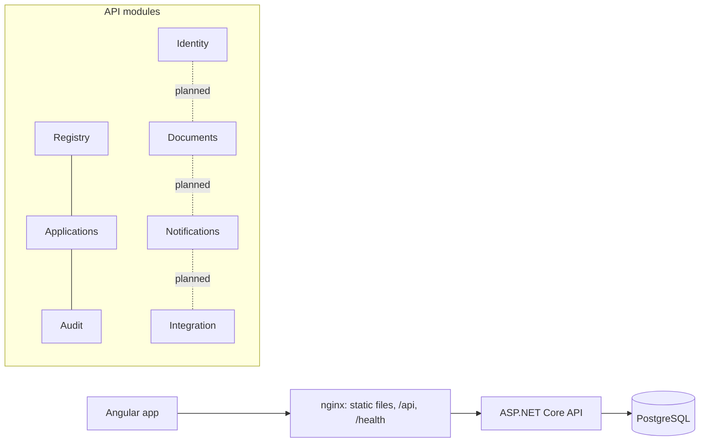

# Architecture

## Layers (dependencies point inward)

| Layer | Contains | May depend on |
|---|---|---|
| Domain | entities, workflow engine, audit chain, calendar, value objects | nothing |
| Application | use cases, ports (`IServiceCatalog`, `IAuditLog`), validators | Domain |
| Infrastructure | EF Core, PostgreSQL, adapters | Application, Domain |
| Api | controllers, middleware, configuration | Application, Infrastructure |

Business rules live in Domain and are unit-tested without a database. Infrastructure is tested against a real
PostgreSQL via Testcontainers, never an in-memory fake.

## Module boundaries
A module owns its tables and exposes interfaces; other modules never read its tables directly. Cross-module reactions
(notifications, audit) will use an outbox of domain events written in the same transaction as the change. This keeps the
option to extract a module into a service later without a rewrite.

## Cross-cutting
Structured logs (Serilog), RFC 9457 problem responses with a trace id, health endpoints (`/health/live`, `/health/ready`),
per-IP rate limiting, security headers, CORS allow-list, versioned routes (`/api/v1`), OpenAPI. Time comes from
`TimeProvider`, ids are UUIDv7, timestamps are UTC.

## Request flow (service directory)
Browser -> `GET /api/v1/services?language=am&search=tax` -> controller -> `ServiceDirectoryService` (validates) ->
`IServiceCatalog` (EF Core query, parameterised, wildcard-escaped) -> DTOs localised with English fallback.
